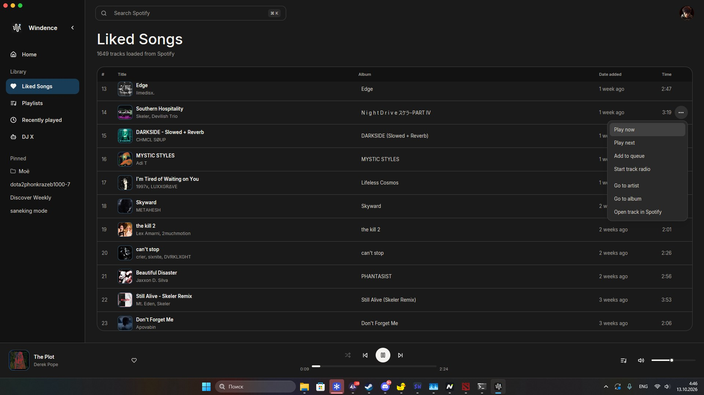

<p align="center">
  
</p>

<h1 align="center">Windence</h1>

<p align="center">
  A minimal Spotify player for Windows.<br>
  Native and responsive, built with Rust and GPUI.
</p>

<p align="center">
  <a href="https://apps.microsoft.com/detail/9PJ0NRJRJWH8"></a>
</p>

<p align="center">
  <a href="https://get.microsoft.com/installer/download/9PJ0NRJRJWH8?referrer=appbadge&amp;source=github.com">Download the Microsoft Store installer</a>
  · <a href="https://github.com/ForeverInLaw/windence/releases">Release notes</a>
  · <a href="PRIVACY.md">Privacy policy</a>
  · <a href="LICENSE">MIT license</a>
</p>



## Install

Install Windence from [Microsoft Store](https://apps.microsoft.com/detail/9PJ0NRJRJWH8).
Microsoft signs the app and delivers updates through Store.

You can also use the **Microsoft Store installer** linked above or attached to
our GitHub releases. Microsoft generates this small executable. It downloads
and installs the latest certified Store version available in your market.
Store availability can lag behind a source release while certification completes.

You need:

- Windows 10 version 2004 (build 19041) or newer, or Windows 11, on an x64 PC.
- A Spotify Premium account.
- A Spotify developer Client ID. Windence guides you through setup on first launch.

If you used an older Cadence or Windence installer, close that app completely
before opening the Store copy. Both use the existing `%APPDATA%\Cadence` profile
and Windows Credential Manager entries. See the
[migration checklist](docs/windows-validation.md#store-package) before removing
the old installation.

## Set up Spotify

Client IDs are public; Windence never asks for your client secret.

1. Create an app in the [Spotify Developer Dashboard](https://developer.spotify.com/dashboard).
2. Add `http://127.0.0.1:8888/callback` as a redirect URI.
3. Copy the Client ID from **Basic Information** and enter it in Windence.
4. Sign in through your default browser.

Windence keeps preferences in a local SQLite database and authentication tokens
in Windows Credential Manager. The [privacy policy](PRIVACY.md) describes local
data and Spotify access.

## Features

- Spotify Home, saved tracks, playlists, artists and albums.
- Search across Spotify and within a playlist.
- Playlist pages and a local cache for faster browsing.
- Queue, playback history, shuffle, Smart Shuffle and track radio.
- Windows system media controls (SMTC).
- Keyboard navigation and light, dark or system appearance.
- Saved playback position and library state across restarts.

GPUI renders the interface, rspotify connects to the Spotify Web API, and SQLite
keeps local state. Audio streams through librespot and CPAL into Windows WASAPI,
following the default output device when it changes.

## Build from source

Use a 64-bit Windows 10 or 11 machine with:

- [Rust](https://rustup.rs). `rustup` installs the toolchain pinned in `rust-toolchain.toml`.
- [Visual Studio Build Tools](https://visualstudio.microsoft.com/downloads/) with
  the **Desktop development with C++** workload and Windows SDK.

Neither CMake nor NASM is required. Run:

```sh
cargo run
```

During development you can set the Client ID before launching:

```powershell
$env:SPOTIFY_CLIENT_ID = "your-client-id"
cargo run
```

## Packages and releases

Stable version tags build the app and submit its MSIX to Microsoft Store.
The tagged commit must be merged into `windows-port`. CI delivery is enabled;
Store certification and publication happen after submission. A pending Store
submission blocks a new one. See the [delivery guide](docs/microsoft-store.md).

The Release workflow also downloads Microsoft's Store installer and verifies
its Microsoft signature on Windows. This installer always retrieves the latest
certified Store version; it is separate from our development setup EXE.

To build the upload package locally:

```powershell
scripts\package-msix.ps1
```

The unsigned `.msix` in `dist\store` is for Partner Center. It is a technical
release artifact, not the public installer. Microsoft signs the Store-delivered
package after certification.

To build development packages:

```powershell
scripts\package-windows.ps1
```

The development installer and ZIP are written to `dist\development` and kept
in GitHub Actions artifacts. They are unsigned and can show a Windows publisher
warning. GitHub releases direct users to Microsoft Store and its installer.

## Validate changes

The UI stack is pinned to gpui-kit 0.7.3 and gpui-pre 0.3.9. Run the Windows CI checks:

```sh
cargo fmt --all --check
cargo build --locked
cargo clippy --all-targets --locked -- -D warnings
cargo test --locked
```

Tests cover controls, keyboard input and layout without GPU snapshots. CI also
checks MSIX installation and onboarding using a separately signed test copy.
Use the [native Windows checklist](docs/windows-validation.md) for OAuth,
device audio, SMTC, window behavior and Store updates.

## Upstream and license

Windence is the Windows-only Port of [infomiho/cadence](https://github.com/infomiho/cadence).
The original macOS sources remain for upstream merges and are excluded from
Windows builds. Its README covers macOS builds and releases.

Windence is licensed under [MIT](LICENSE). Attribution and dependency notices
are in [THIRD_PARTY_NOTICES.md](THIRD_PARTY_NOTICES.md).
